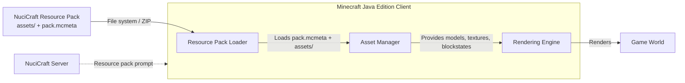
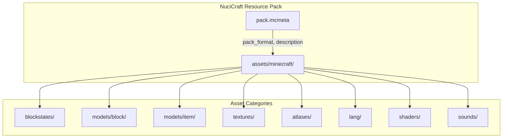
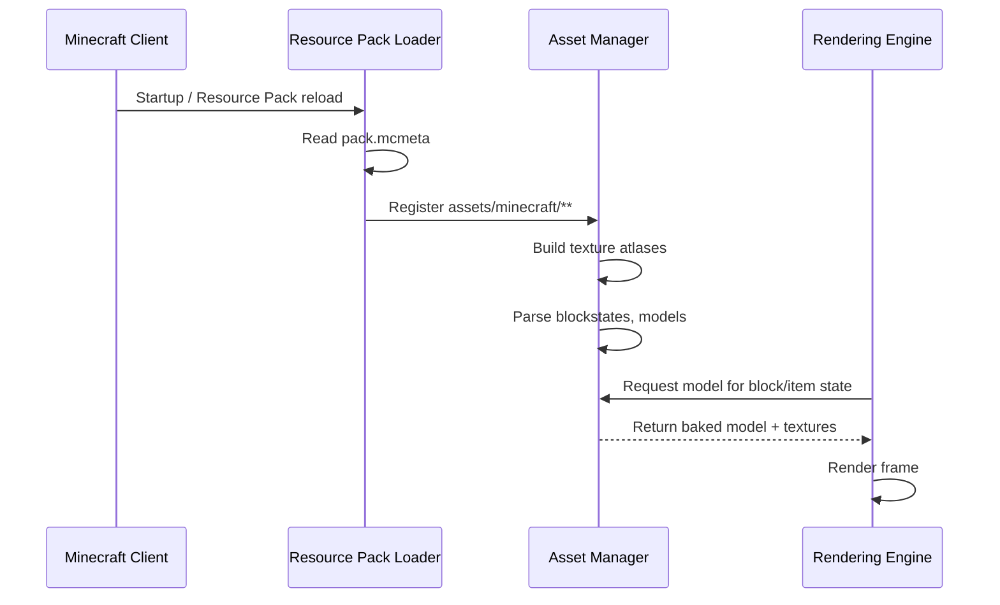
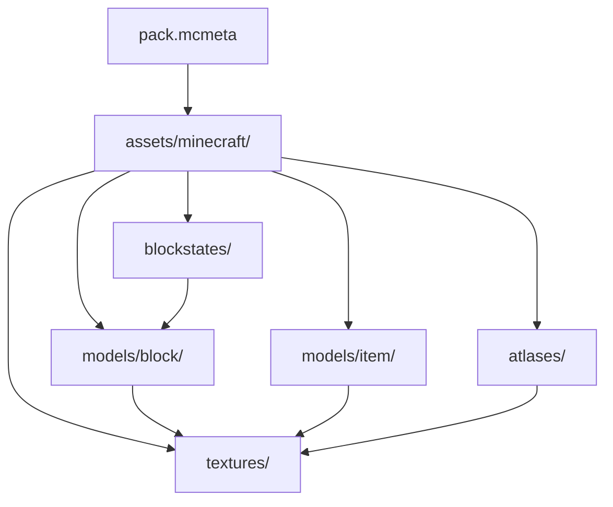

# NuciCraft Resource Pack Architecture

This document describes the current architecture of the NuciCraft Resource Pack, a Minecraft Java Edition resource pack for the NuciCraft private server. It covers the pack structure, asset organisation, and integration boundaries with the Minecraft client.

## 📑 Table of Contents

- [Purpose](#purpose)
- [System Context](#system-context)
- [Architectural Style](#architectural-style)
- [Runtime Flow](#runtime-flow)
- [Architectural Areas](#architectural-areas)
- [Data Architecture](#data-architecture)
- [Interfaces and Integrations](#interfaces-and-integrations)
- [Dependency Direction and Rules](#dependency-direction-and-rules)
- [External Dependencies](#external-dependencies)
- [Deployment and Operations](#deployment-and-operations)
- [Compatibility Contracts](#compatibility-contracts)
- [Testing and Verification](#testing-and-verification)
- [Design Constraints](#design-constraints)
- [Related Documentation](#related-documentation)

## 🎯 Purpose

This document defines the architectural boundaries of the NuciCraft Resource Pack. The pack provides custom 3D block and item models, texture tweaks, variations, renamed elements, and performance optimisations for the NuciCraft private server. The intended audience is maintainers and contributors who need to understand the pack structure, asset ownership, and integration points with the Minecraft client.

## 🌐 System Context

The NuciCraft Resource Pack is a data-only resource pack loaded by the Minecraft Java Edition client. It does not execute code; it declares assets that the client renders.



The principal external boundaries are:
- **Minecraft Client Resource Pack Loader:** Reads `pack.mcmeta` and the `assets/` directory; validates `pack_format` compatibility.
- **Minecraft Rendering Engine:** Consumes block/item models, textures, blockstates, and atlases to render the world.
- **Minecraft Asset Manager:** Resolves asset paths, handles overrides, and manages texture atlases.
- **NuciCraft Server (optional):** May prompt clients to download and enable the pack via `server-resource-packs` in `server.properties`.

## 🏗️ Architectural Style

The pack follows a **declarative data-driven architecture** conforming to the Minecraft resource pack specification. Assets are organised by Minecraft's expected directory structure under `assets/minecraft/`. The pack declares no executable logic; all behaviour is interpreted by the client's rendering engine.



The principal architecture boundaries are:
- **Pack Metadata (`pack.mcmeta`):** Declares `pack_format` (107.1) and description; controls client compatibility.
- **Blockstates (`assets/minecraft/blockstates/`):** Maps block states to model variants; owned by block authors.
- **Block Models (`assets/minecraft/models/block/`):** Defines 3D geometry for blocks; includes variants for custom fence gates, doors, leaves, slabs, stairs, and community pack integrations.
- **Item Models (`assets/minecraft/models/item/`):** Defines 3D geometry and display transforms for items; includes custom items (e.g., `magic_compass.json`).
- **Textures (`assets/minecraft/textures/`):** Source images for models; organised by block/item/category.
- **Atlases (`assets/minecraft/atlases/`):** Texture atlas configuration for block/entity atlases.
- **Language (`assets/minecraft/lang/`):** Translation overrides for renamed blocks/items (e.g., Bamboo → Bambus).
- **Shaders (`assets/minecraft/shaders/`):** Post-processing shaders (if any).
- **Sounds (`assets/minecraft/sounds/`):** Custom sound events (if any).

## 🔄 Runtime Flow



The principal runtime sequence is:
1. Client starts or reloads resource packs.
2. Loader reads `pack.mcmeta`, validates `pack_format`.
3. Asset Manager indexes all files under `assets/minecraft/`.
4. Texture atlases are built from `textures/` and `atlases/`.
5. Blockstates and models are parsed and baked.
6. During rendering, the engine requests models for each block/item state.
7. Manager returns baked models with resolved textures.
8. Renderer draws the frame.

## 🗂️ Architectural Areas

### Blockstates

Paths:
- `assets/minecraft/blockstates/`

Responsibilities:
- Map block state properties (e.g., `facing`, `open`, `waterlogged`) to model variants.
- Define multipart models for complex blocks (fences, doors, leaves).

Boundary rules:
- Must reference models under `assets/minecraft/models/block/`.
- Variant names must match Minecraft's expected state properties.

### Block Models

Paths:
- `assets/minecraft/models/block/`
- `assets/minecraft/models/block/andesite/`
- `assets/minecraft/models/block/birch_log/`
- `assets/minecraft/models/block/variated/`

Responsibilities:
- Define 3D geometry (elements, faces, UV mapping) for blocks.
- Support custom variations (e.g., `birch_log/`, `variated/` for randomised textures).
- Integrate community pack models (VanillaTweaks, MCjossic, etc.) under consistent paths.

Boundary rules:
- Parent models may reference vanilla or custom parents.
- Textures must resolve under `assets/minecraft/textures/block/`.
- No circular parent references.

### Item Models

Paths:
- `assets/minecraft/models/item/`

Responsibilities:
- Define 3D geometry and display transforms (firstperson, thirdperson, gui, head, ground, fixed) for items.
- Map custom items (e.g., `magic_compass.json`) to textures and models.

Boundary rules:
- Must reference textures under `assets/minecraft/textures/item/`.
- Display transforms should follow Minecraft conventions.

### Textures

Paths:
- `assets/minecraft/textures/block/`
- `assets/minecraft/textures/item/`
- `assets/minecraft/textures/...` (other categories)

Responsibilities:
- Provide pixel data for models.
- Support animations via `.mcmeta` files.
- Include community pack textures (VanillaTweaks, Faithful 32x, etc.).

Boundary rules:
- Dimensions must be powers of two (16x, 32x, etc.).
- Animation metadata follows Minecraft's `.mcmeta` format.

### Atlases

Paths:
- `assets/minecraft/atlases/blocks.json`

Responsibilities:
- Configure texture atlas sources for blocks and entities.

Boundary rules:
- Sources must exist under `textures/`.

### Language

Paths:
- `assets/minecraft/lang/`

Responsibilities:
- Override vanilla translation keys for renamed blocks/items (Romanian, custom names).

Boundary rules:
- Keys must match Minecraft's translation keys.
- Values are free-form text.

## 💾 Data Architecture

The pack owns no persistent state at runtime. All data is static asset files read by the client.

```mermaid
flowchart LR
    Files[Static Asset Files\n(JSON, PNG, OGG, GLSL)] -->|Load| Manager[Asset Manager]
    Manager -->|Bake| Models[Baked Models]
    Manager -->|Upload| GPU[GPU Textures]
    Models --> Renderer
    GPU --> Renderer
```

| Data or Store | Owner | Representation and Storage | Lifecycle or Consistency |
|---------------|-------|----------------------------|--------------------------|
| `pack.mcmeta` | Pack root | JSON (pack_format, description) | Immutable per release |
| Blockstates | Block authors | JSON (variant → model mapping) | Immutable per release |
| Block Models | Block authors | JSON (elements, faces, parents) | Immutable per release |
| Item Models | Item authors | JSON (elements, display transforms) | Immutable per release |
| Textures | Texture artists | PNG (+ optional .mcmeta) | Immutable per release |
| Atlases | Pack maintainer | JSON (source list) | Immutable per release |
| Language | Translators | JSON (key → value) | Immutable per release |

## 🔌 Interfaces and Integrations

| Interface or Integration | Direction | Contract | Owner | Failure Semantics |
|--------------------------|-----------|----------|-------|-------------------|
| Minecraft Resource Pack Loader | Inbound | `pack.mcmeta` + `assets/minecraft/**` | Pack maintainer | Pack ignored; fallback to vanilla |
| Minecraft Rendering Engine | Inbound | Block/item model JSON schema | Pack maintainer | Missing model → purple/black checkerboard |
| Minecraft Asset Manager | Inbound | Texture atlas config (`atlases/blocks.json`) | Pack maintainer | Missing texture → magenta |
| NuciCraft Server (resource pack prompt) | Outbound | `server-resource-packs` in `server.properties` | Server operator | Client downloads or declines |

## 🧭 Dependency Direction and Rules



The principal dependency rules are:
- `pack.mcmeta` is the root; no asset depends on it.
- `blockstates/` depends on `models/block/`.
- `models/block/` and `models/item/` depend on `textures/`.
- `atlases/` depends on `textures/`.
- `lang/` is independent (referenced by client, not by other assets).
- No asset depends on `shaders/` or `sounds/` unless explicitly referenced.
- Community pack integrations are vendored under standard paths; no external runtime dependency.

## 📦 External Dependencies

| Dependency | Responsibility | Integration Boundary | Architectural Consequence |
|------------|----------------|----------------------|---------------------------|
| Minecraft Java Edition | Host platform, rendering engine, asset loader | `pack_format` 107.1 | Pack must target compatible version; breaking changes in pack format require updates |
| VanillaTweaks (community pack) | Source of tweaks/models/textures | Vendored under `assets/minecraft/**` | No runtime dependency; updates require manual re-vendoring |
| Faithful 32x (community pack) | Source of 32x item textures | Vendored under `assets/minecraft/textures/item/` | No runtime dependency |
| Other community packs (MCjossic, Saplistic, Ecorn, etc.) | Source of 3D models/textures | Vendored under `assets/minecraft/**` | No runtime dependency |

## 🚀 Deployment and Operations

| Concern | Current Design | Architectural Consequence |
|---------|----------------|---------------------------|
| Distribution | GitHub Releases (ZIP: `nucicraft_6.3.4.zip`) | Users download and place in `resourcepacks/` folder |
| Installation | Manual copy to `%appdata%/.minecraft/resourcepacks/` (Windows) or `~/.minecraft/resourcepacks/` (Linux/macOS) | No installer; user-managed |
| Server-side prompt | `server-resource-packs` in `server.properties` (optional) | Clients auto-download on join if configured |
| Versioning | `pack.mcmeta` description + Git tags + ZIP filename | `pack_format` ties to Minecraft version |
| Updates | Replace ZIP; client reloads via F3+T or restart | No hot-reload of individual assets |
| Persistent state | None | No migration needed |

## 🛡️ Compatibility Contracts

| Contract | Owner | Invariant | Verification | Change Policy |
|----------|-------|-----------|--------------|---------------|
| `pack_format` | Pack maintainer | Matches target Minecraft version | Client loads pack without error | Update on Minecraft version upgrade |
| Blockstate → Model references | Block authors | All variant models exist | Client logs missing model errors | Add missing models before release |
| Model → Texture references | Model authors | All texture paths resolve | Client logs missing texture errors | Add missing textures before release |
| Language keys | Translators | Keys match vanilla translation keys | In-game text appears correctly | Update keys on vanilla changes |

## ✅ Testing and Verification

No automated test suite exists. Verification is manual:

```bash
# Manual verification steps:
# 1. Install pack in Minecraft client
# 2. Load a world with the pack enabled
# 3. Verify:
#    - Custom 3D models render correctly (doors, fences, chains, etc.)
#    - Texture variations appear (birch log, cobblestone, ores, etc.)
#    - Renamed items/blocks show custom names (Bambus, Sakura, Cement, etc.)
#    - No purple/black checkerboard (missing model) or magenta (missing texture)
#    - Performance acceptable (no excessive model complexity)
# 4. Test with server resource pack prompt (if configured)
```

Execute the principal automated verification with:
```bash
# No automated verification commands exist.
# Verification is manual via Minecraft client.
```

## ⚠️ Design Constraints

- **Minecraft pack_format coupling:** The pack is bound to `pack_format` 107.1 (Minecraft 1.21.x). Upgrading Minecraft may require pack format changes.
- **No runtime logic:** All behaviour is declarative; dynamic effects require client-side mods (not in scope).
- **Texture atlas limits:** Excessive unique textures can exceed atlas capacity; variations must be balanced.
- **Model complexity budget:** High-poly models impact render performance; community models are vetted for complexity.
- **Vendor lock-in:** Community pack assets are vendored; upstream updates require manual integration.
- **Single-player / server parity:** Pack works in single-player and on servers that prompt it; no server-side component.
- **Language maintenance:** Custom translations must be kept in sync with vanilla key changes.

## 📚 Related Documentation

- [Contributing Guidelines](./CONTRIBUTING.md) — Contribution process, code style, and pull request requirements.
- [Code of Conduct](./CODE_OF_CONDUCT.md) — Community standards and moderation policy.
- [Security Policy](./SECURITY.md) — Supported versions, vulnerability reporting, and disclosure policy.
- [Privacy Policy](./PRIVACY.md) — Data handling and personal data practices.
- [License](./LICENSE) — GNU General Public License v3.0 terms.